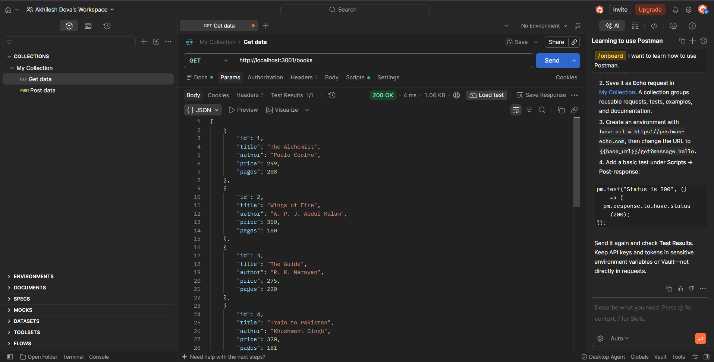
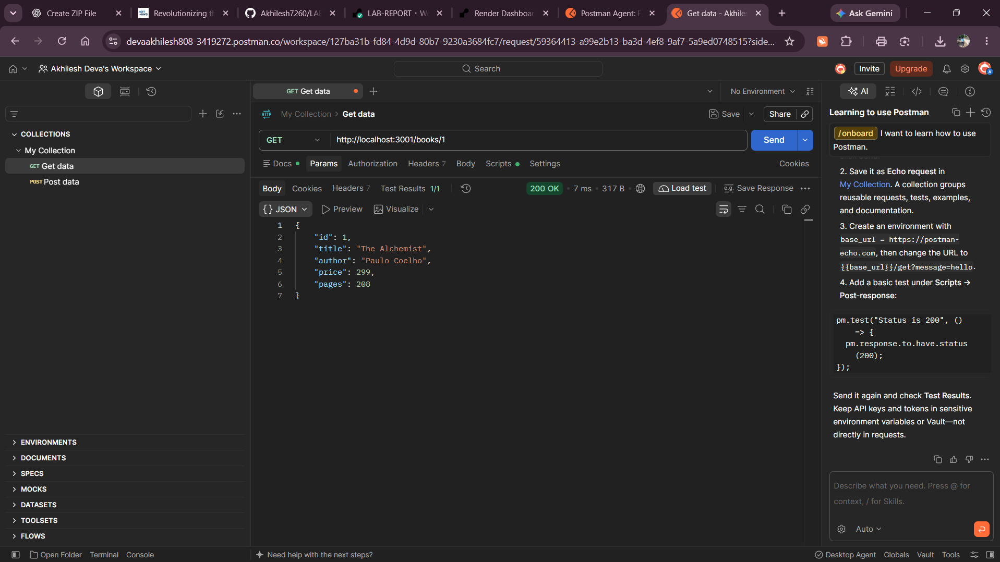
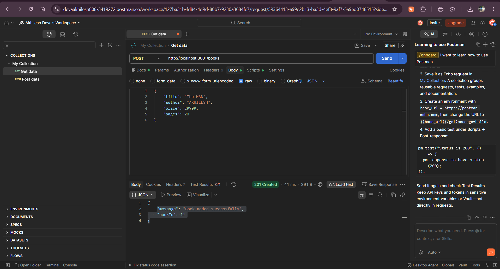
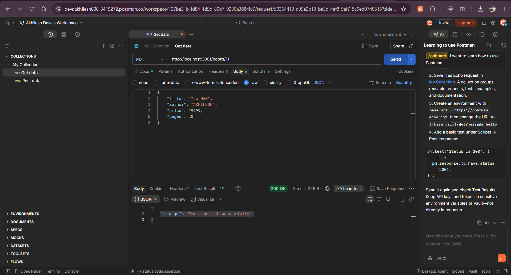
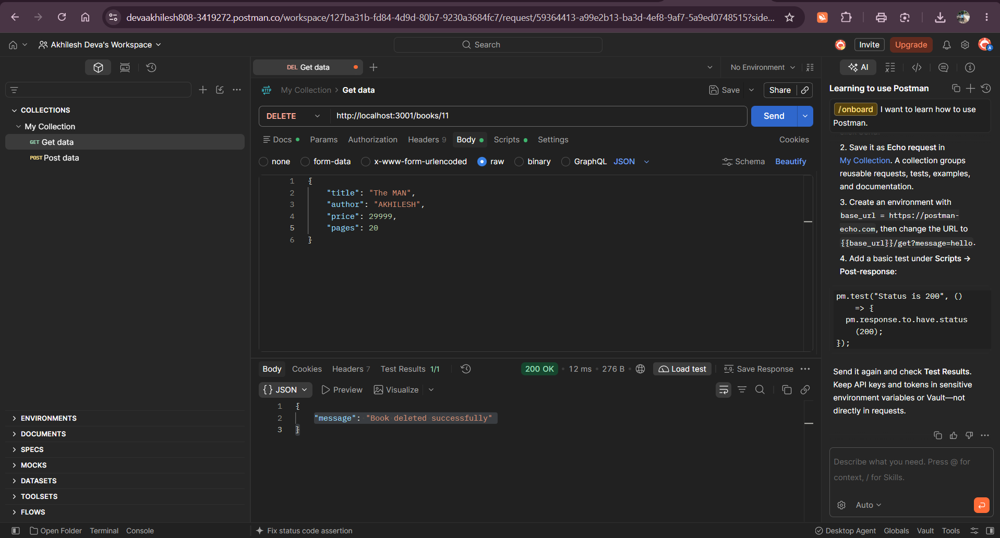
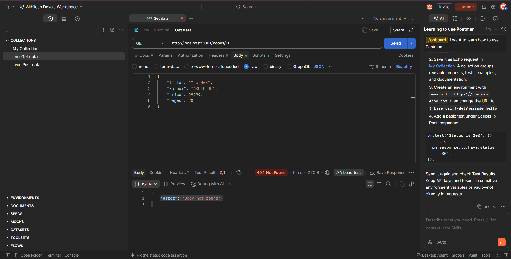
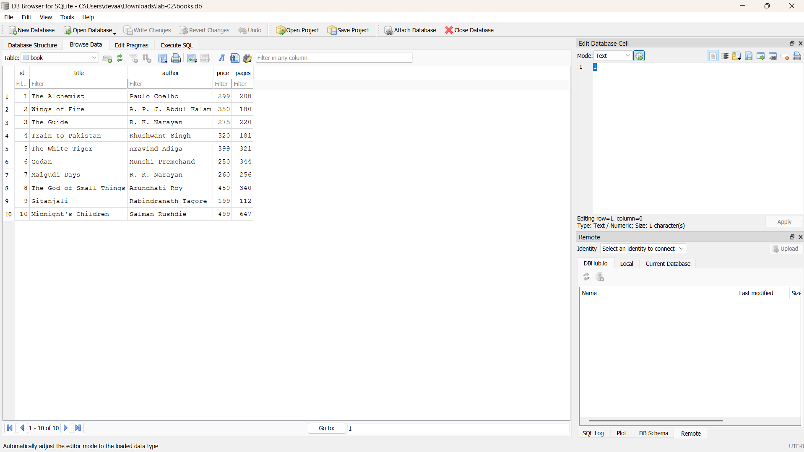

# Lab 2: SQLite database and CRUD routes

**Name:** DEVA AKHILESH · **Registration number:** 252U1R9030 · **Section:** CSE-2A-304

**Live link:** PASTE PUBLIC URL HERE (or explain why the project could not be deployed)

## How to run

```bash
npm install            # installs express, sqlite, sqlite3 and nodemon
npm run dev            # starts the server with nodemon (restarts on every change)
# or: npm start        # plain node
```

Environment variables: `PORT` (optional, default `3000`). No secrets are needed.

The database file `books.db` is included. To recreate it from scratch:

```bash
rm books.db
sqlite3 books.db < schema.sql
```

## Endpoints

| Method | Path | Description |
|--------|------|-------------|
| GET | `/books/` | Return all books |
| GET | `/books/:bookId/` | Return one book (404 if missing) |
| POST | `/books/` | Add a book, returns 201 with the new id |
| PUT | `/books/:bookId/` | Replace all fields of a book (404 if missing) |
| DELETE | `/books/:bookId/` | Delete a book (404 if missing) |

Status codes: 200 success, 201 created, 400 invalid id or body, 404 not found, 500 server error.

Sample POST/PUT body:

```json
{ "title": "Godan", "author": "Munshi Premchand", "price": 250, "pages": 344 }
```

## Screenshots

Add Postman screenshots to `screenshots/` and reference them like this:









## Notes

- Problems faced and how I solved them: WRITE HERE.
- All queries that take user input use `?` placeholders, so input is never joined into the SQL string.
- `initializeDBAndServer()` starts the server only after the database connection succeeds.
