# Lab 03: REST API, Query Parameters, Validation, and Debugging

## Student Details

| Field | Details |
|---|---|
| **Student Name** | D. Akhilesh |
| **Registration Number** | 252U1R9030 |
| **Course** | Backend Development Fundamentals |
| **Branch** | CSE – Gen AI |
| **Institution** | Aurora |
| **Faculty** | Joel Prashanth D |

---

## Project Overview

This project demonstrates the creation of a RESTful API using **Node.js**, **Express.js**, and **SQLite**. It implements full CRUD operations for a Books resource, along with advanced query parameters (search, sort, filter, pagination), comprehensive input validation, and robust error handling and debugging.

---

## Objectives

- Build a REST API with Express.js.
- Implement CRUD operations (Create, Read, Update, Delete).
- Add search, sorting, filtering, and pagination using query parameters.
- Validate all user inputs with meaningful error messages.
- Use appropriate HTTP status codes.
- Handle common backend errors and debugging scenarios.
- Use parameterized SQL queries to prevent SQL injection.

---

## Technologies Used

| Technology | Purpose |
|---|---|
| **Node.js** | Runtime environment |
| **Express.js** | Web framework for REST API |
| **SQLite** | Lightweight relational database |
| **JavaScript** | Programming language |
| **Postman** | API testing |

---

## Folder Structure

```
lab-03/
│
├── screenshots/
│   ├── get-all-books.png
│   ├── search-query-java.png
│   ├── sort-by-price-desc.png
│   ├── filter-by-price-range.png
│   ├── pagination-limit-3-offset-0.png
│   ├── invalid-query-param.png
│   ├── post-missing-title.png
│   ├── post-invalid-price.png
│   ├── get-book-not-found.png
│   ├── post-create-book.png
│   └── delete-book.png
│
├── app.js
├── database.js
├── initDB.sql
├── package.json
├── package-lock.json
├── .gitignore
└── README.md
```

---

## Database Schema

### Table: `books`

| Column | Type | Constraints |
|---|---|---|
| `id` | INTEGER | PRIMARY KEY AUTOINCREMENT |
| `title` | TEXT | NOT NULL |
| `author` | TEXT | NOT NULL |
| `price` | REAL | NOT NULL |
| `pages` | INTEGER | – |

### Sample Data (10 Books)

| ID | Title | Author | Price | Pages |
|---|---|---|---|---|
| 1 | The Pragmatic Programmer | David Thomas | 450.00 | 352 |
| 2 | Clean Code | Robert C. Martin | 550.00 | 464 |
| 3 | JavaScript: The Good Parts | Douglas Crockford | 320.00 | 176 |
| 4 | Head First Java | Kathy Sierra | 680.00 | 720 |
| 5 | Effective Java | Joshua Bloch | 520.00 | 416 |
| 6 | Design Patterns | Erich Gamma | 600.00 | 395 |
| 7 | Node.js Design Patterns | Mario Casciaro | 480.00 | 528 |
| 8 | Learning Python | Mark Lutz | 750.00 | 1648 |
| 9 | Java Concurrency in Practice | Brian Goetz | 490.00 | 384 |
| 10 | You Dont Know JS | Kyle Simpson | 380.00 | 278 |

---

## Installation Instructions

### Prerequisites

- **Node.js** (v14 or above)
- **npm** (comes with Node.js)
- **Postman** (for API testing)

### Setup

1. Clone the repository and navigate to the lab-03 folder:

```bash
cd lab-03
```

2. Install dependencies:

```bash
npm install
```

3. Start the server:

```bash
npm start
```

4. The server will start at:

```
http://localhost:3000
```

The SQLite database (`books.db`) is created automatically when the server starts for the first time. Seed data is inserted only if the database is empty, preventing duplicate records on restart.

---

## API Endpoints

### 1. GET `/` – API Welcome

**Response:**

```json
{
  "message": "Welcome to the Books REST API!",
  "version": "1.0.0",
  "endpoints": {
    "GET /": "API welcome information",
    "GET /books": "Get all books (supports search, sort, filter, pagination)",
    "GET /books/:id": "Get a book by ID",
    "POST /books": "Add a new book",
    "PUT /books/:id": "Update an existing book",
    "DELETE /books/:id": "Delete a book"
  }
}
```

### 2. GET `/books` – Get All Books

**Response:**

```json
{
  "total": 10,
  "books": [
    {
      "id": 1,
      "title": "The Pragmatic Programmer",
      "author": "David Thomas",
      "price": 450,
      "pages": 352
    }
  ]
}
```

### 3. GET `/books/:id` – Get a Book by ID

**Request:** `GET /books/1`

**Response:**

```json
{
  "book": {
    "id": 1,
    "title": "The Pragmatic Programmer",
    "author": "David Thomas",
    "price": 450,
    "pages": 352
  }
}
```

### 4. POST `/books` – Add a New Book

**Request Body:**

```json
{
  "title": "Express in Action",
  "author": "Evan Hahn",
  "price": 420,
  "pages": 256
}
```

**Response (201):**

```json
{
  "message": "Book created successfully.",
  "book": {
    "id": 11,
    "title": "Express in Action",
    "author": "Evan Hahn",
    "price": 420,
    "pages": 256
  }
}
```

### 5. PUT `/books/:id` – Update a Book

**Request:** `PUT /books/1`

**Request Body:**

```json
{
  "title": "The Pragmatic Programmer (2nd Edition)",
  "author": "David Thomas",
  "price": 500,
  "pages": 380
}
```

**Response (200):**

```json
{
  "message": "Book updated successfully.",
  "book": {
    "id": 1,
    "title": "The Pragmatic Programmer (2nd Edition)",
    "author": "David Thomas",
    "price": 500,
    "pages": 380
  }
}
```

### 6. DELETE `/books/:id` – Delete a Book

**Request:** `DELETE /books/11`

**Response (200):**

```json
{
  "message": "Book with ID 11 deleted successfully.",
  "book": {
    "id": 11,
    "title": "Express in Action",
    "author": "Evan Hahn",
    "price": 420,
    "pages": 256
  }
}
```

---

## Query Parameters

### Search by Title

```
GET /books?search_q=Java
```

Returns books with "Java" in the title (partial, case-insensitive match).

### Sort by Column

```
GET /books?order_by=price&order=DESC
```

Supported columns: `id`, `title`, `author`, `price`, `pages`
Supported directions: `ASC`, `DESC`

### Filter by Price Range

```
GET /books?min_price=300&max_price=600
```

Returns books with price between 300 and 600 (inclusive).

### Pagination

```
GET /books?limit=3&offset=0   → First 3 books
GET /books?limit=3&offset=3   → Next 3 books
```

### Combined Query

```
GET /books?search_q=Java&order_by=price&order=ASC&min_price=400&max_price=700&limit=5&offset=0
```

---

## Validation Rules

| Validation | Error Message | Status Code |
|---|---|---|
| Missing title | "Book title is required and must be a non-empty string." | 400 |
| Missing author | "Author is required and must be a non-empty string." | 400 |
| Missing price | "Price is required." | 400 |
| Invalid price | "Price must be a valid number." | 400 |
| Negative price | "Price must not be negative." | 400 |
| Invalid pages | "Pages must be a valid integer." | 400 |
| Invalid book ID | "Invalid book ID. Must be a positive integer." | 400 |
| Invalid sort column | "Invalid order_by column. Allowed: id, title, author, price, pages." | 400 |
| Invalid sort order | "Invalid order direction. Allowed: ASC, DESC." | 400 |
| Invalid limit | "Invalid limit. Must be a non-negative integer." | 400 |
| Invalid offset | "Invalid offset. Must be a non-negative integer." | 400 |
| Invalid price range | "min_price must be less than or equal to max_price." | 400 |

---

## HTTP Status Codes

| Code | Meaning | Used For |
|---|---|---|
| **200** | OK | Successful GET, PUT, DELETE requests |
| **201** | Created | Successful POST (new book created) |
| **400** | Bad Request | Validation errors, malformed JSON |
| **404** | Not Found | Book not found, invalid route |
| **500** | Internal Server Error | Database or server errors |

---

## Debugging

This application handles the following common backend issues:

| Issue | How It's Handled |
|---|---|
| **Port already in use** | Detects `EADDRINUSE` error and suggests using a different port |
| **Database connection error** | Logs error and exits gracefully |
| **Missing database tables** | `initDB.sql` creates tables with `IF NOT EXISTS` |
| **Invalid SQL queries** | Caught by try/catch blocks with error logging |
| **Invalid request body** | JSON parse errors return 400 with clear message |
| **Missing route** | 404 handler catches all undefined routes |
| **Incorrect query parameters** | Validated before query execution with descriptive errors |

### Console Messages

- `✅ Connected to SQLite database` – Database connection successful
- `✅ Database initialized. Total books: 10` – Seed data loaded
- `🚀 Server is running on http://0.0.0.0:3000` – Server started
- `❌ Port 3000 is already in use` – Port conflict detected

---

## Screenshots

> **Note:** Screenshots should be captured from actual Postman testing. Below are the expected screenshot references.

### 1. Get All Books
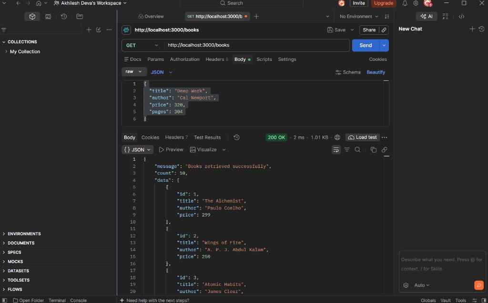

### 2. Search Query – Java
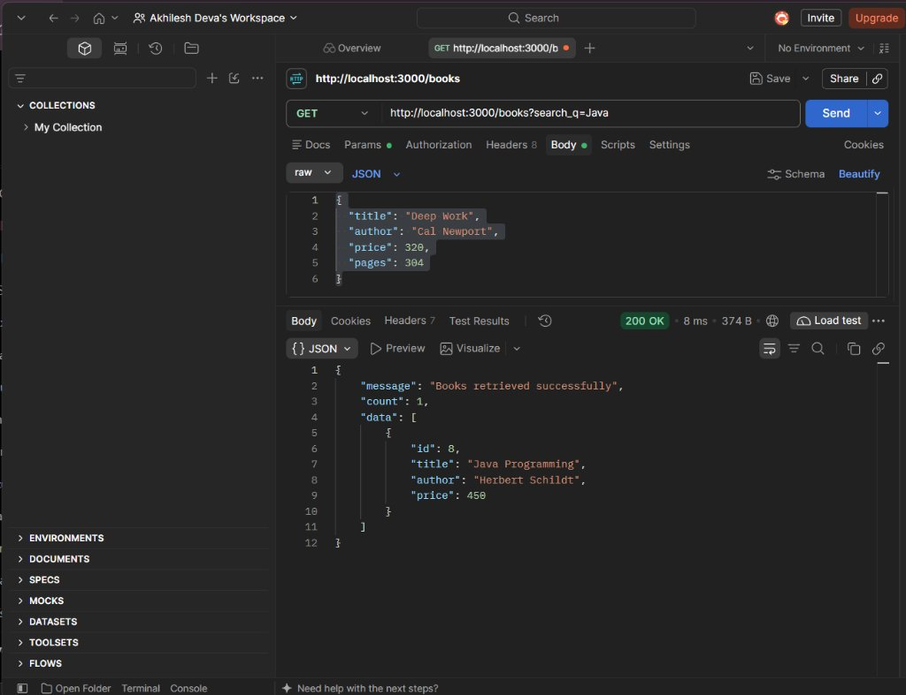

### 3. Sort by Price (DESC)
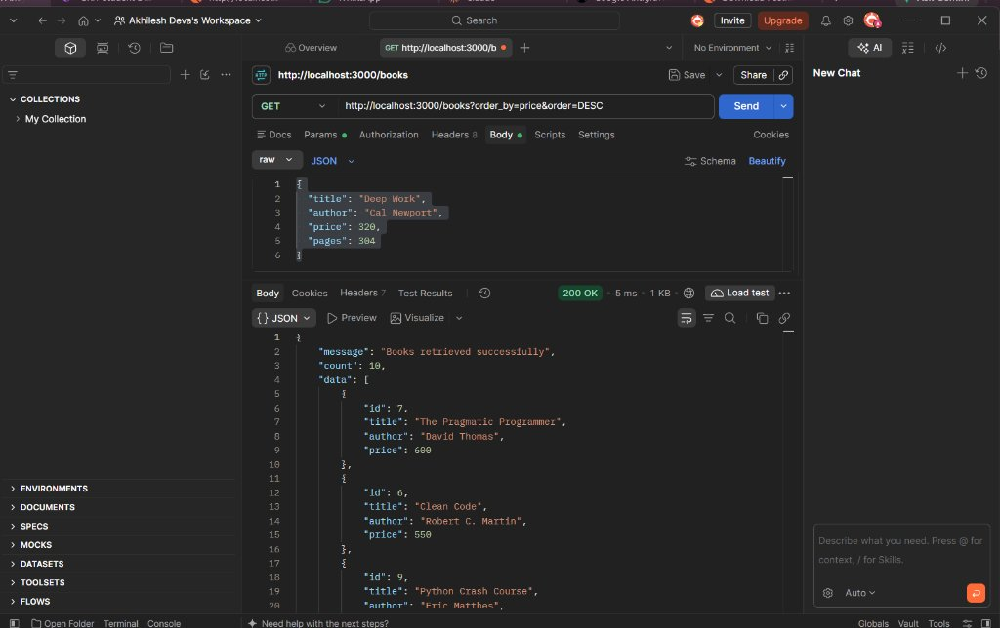

### 4. Filter by Price Range
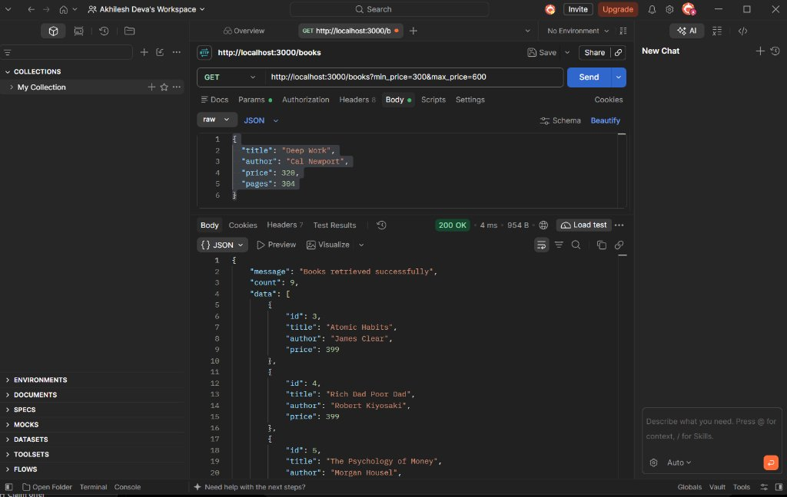

### 5. Pagination (Limit 3, Offset 0)
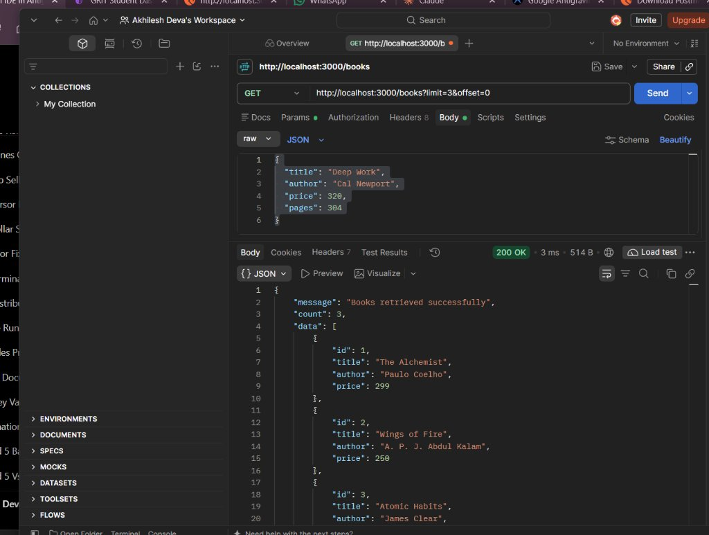

### 6. Invalid Query Parameter
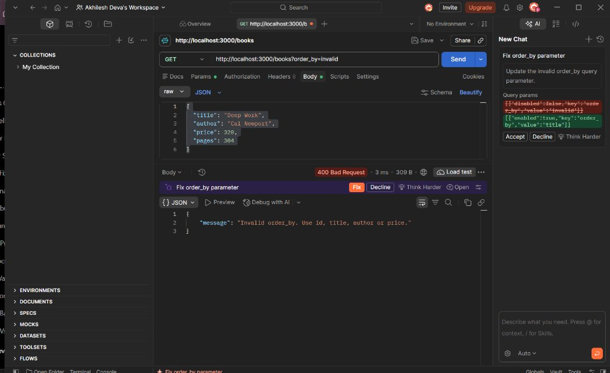

### 7. POST – Missing Title
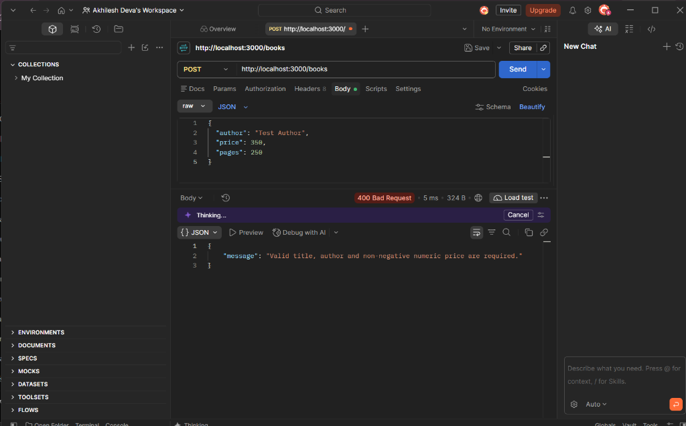

### 8. POST – Invalid Price
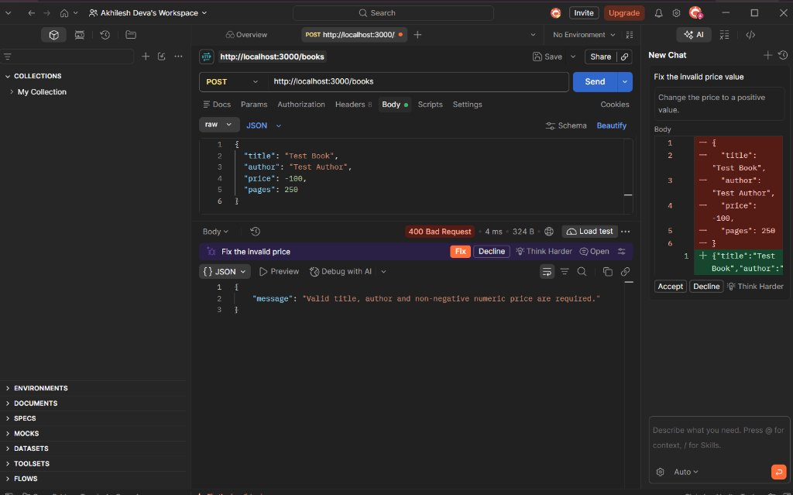

### 9. GET – Book Not Found
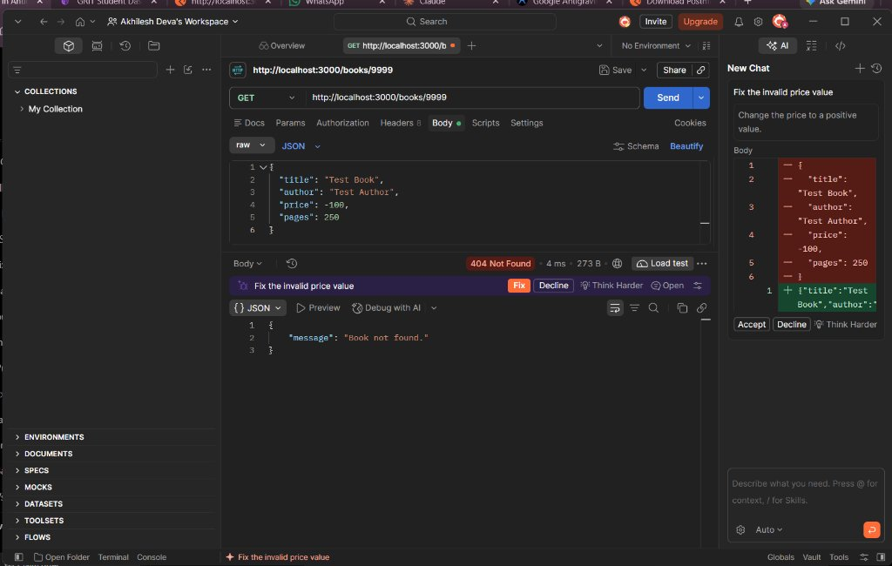

### 10. POST – Create Book
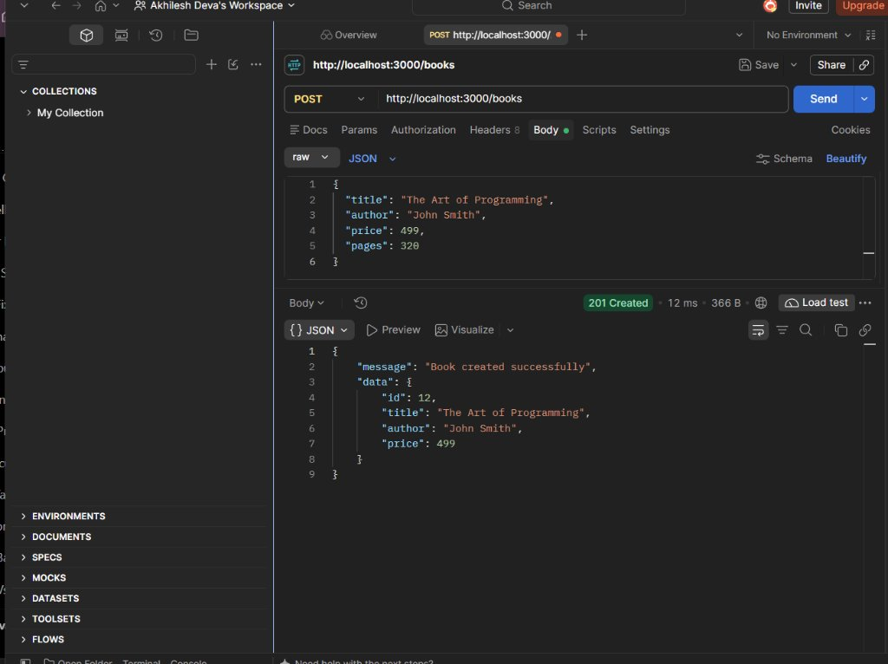

### 11. DELETE – Delete Book
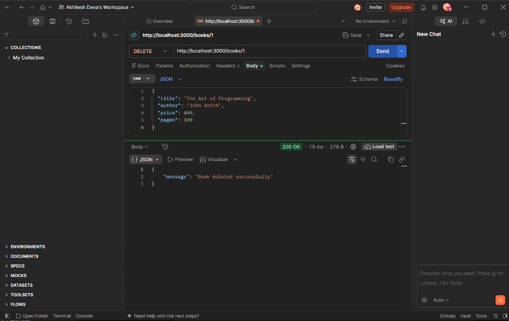

---

## Postman Testing Instructions

Since automatic screenshot capture is unavailable, follow these steps to capture real Postman screenshots:

1. **Import or create requests** in Postman for each endpoint listed above.
2. **Send each request** and verify the response matches the expected output.
3. **Take a screenshot** of each Postman response (include the URL bar, request body, and response).
4. **Save screenshots** in the `screenshots/` folder with the exact filenames listed above.

### Test Requests

| # | Method | URL | Body / Params |
|---|---|---|---|
| 1 | GET | `http://localhost:3000/books` | – |
| 2 | GET | `http://localhost:3000/books?search_q=Java` | – |
| 3 | GET | `http://localhost:3000/books?order_by=price&order=DESC` | – |
| 4 | GET | `http://localhost:3000/books?min_price=300&max_price=600` | – |
| 5 | GET | `http://localhost:3000/books?limit=3&offset=0` | – |
| 6 | GET | `http://localhost:3000/books?order_by=invalid` | – |
| 7 | POST | `http://localhost:3000/books` | `{"author":"Test","price":100}` |
| 8 | POST | `http://localhost:3000/books` | `{"title":"Test","author":"Test","price":"abc"}` |
| 9 | GET | `http://localhost:3000/books/999` | – |
| 10 | POST | `http://localhost:3000/books` | `{"title":"Express in Action","author":"Evan Hahn","price":420,"pages":256}` |
| 11 | DELETE | `http://localhost:3000/books/11` | – |

---

## Deployment Instructions

### Environment Variable

Set a custom port using:

```bash
PORT=5000 npm start
```

### Deployment Platforms

This application is deployment-ready for:

- **Render** – Add a `start` script and set the PORT environment variable.
- **Railway** – Connect your GitHub repo and deploy directly.
- **Heroku** – Use the Procfile: `web: node app.js`

### Render Deployment Steps

1. Push the code to a GitHub repository.
2. Go to [Render Dashboard](https://render.com).
3. Create a new **Web Service**.
4. Connect your GitHub repository.
5. Set the following:
   - **Build Command:** `npm install`
   - **Start Command:** `npm start`
   - **Environment Variable:** `PORT` = (Render sets this automatically)
6. Click **Deploy**.

---

## License

This project is part of the Backend Development Fundamentals course at Aurora.

---

*Built with ❤️ by D. Akhilesh (252U1R9030)*

